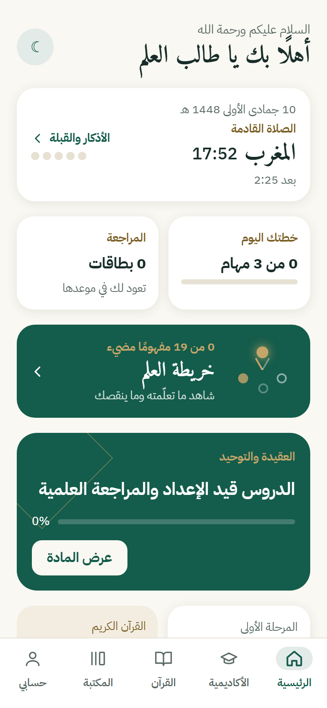
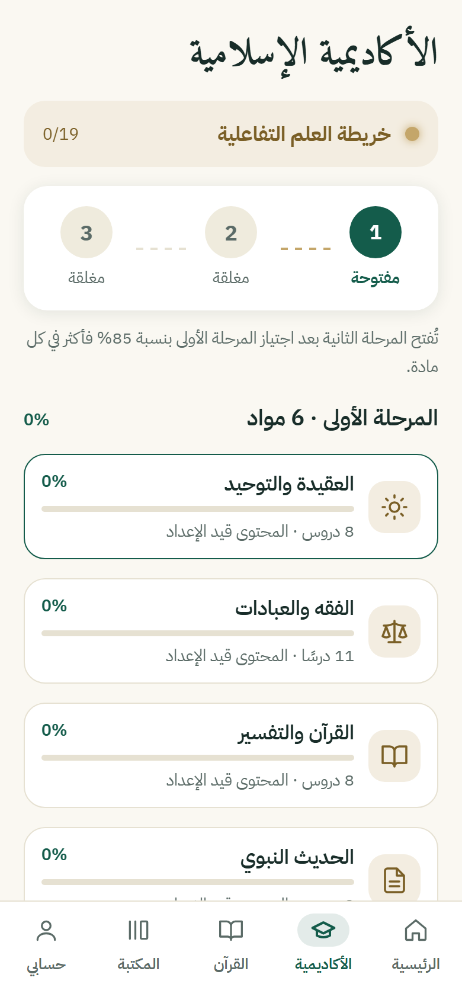
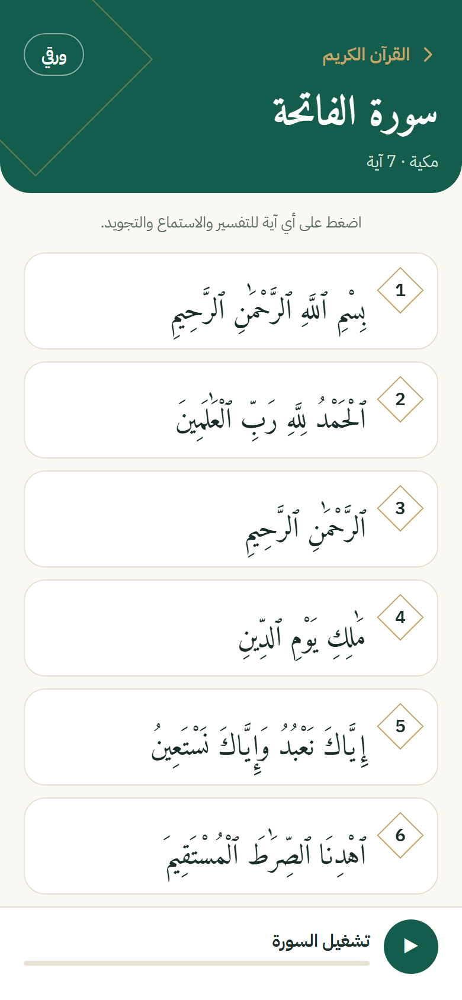
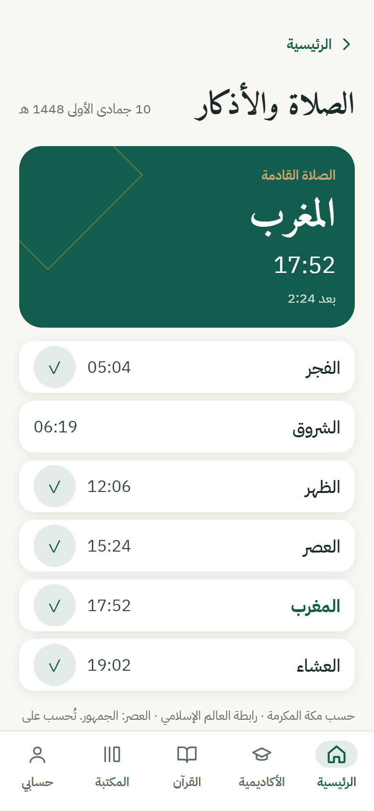
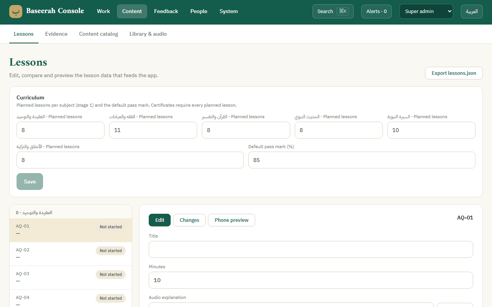

<div align="center">


<a href="#"></a>

<p>
  
  
  
  
  
</p>
<p>
  
  
  
  
</p>

<a href="docs/COVERAGE.md"></a>
<a href="docs/TRACEABILITY.md"></a>
<a href="#baseerah-console-admin"></a>

<br /><br />

&nbsp;
&nbsp;
&nbsp;


</div>

---

## 🕌 About the project

```yaml
name: بصيرة · Baseerah
version: 1.1.0 (versionCode 2)
what: A free, ad-free Arabic (RTL) app for studying the Islamic sciences
covers:
  - a staged academy with lessons, quizzes, certificates and spaced review
  - the Quran (Tanzil Uthmani text) with per-ayah recitation, tafsir, and 604-page Madinah layout
  - a comprehensive verified library (21 complete authentic books) & Islamic terms dictionary
  - prayer times, Qibla (compass + map + 3D Kaaba), adhan audio, widget, adhkar & digital tasbeeh
  - direct in-app auto-updater and native mobile admin console
ships_to: [web, iOS, Android]          # one Expo + React Native + TypeScript codebase
backend: Supabase                      # Postgres + row-level security, Auth, Edge Functions, Storage
staff_console: /admin                  # write, review and publish every piece of content
design_source: design-source/          # Claude Design handoff; see docs/TRACEABILITY.md
golden_rule: >
  No fabricated religious content. Every verse, hadith, quote, tafsir, adhkar text,
  biography and encyclopedia entry stays a dashed «بانتظار التوثيق» slot until scholars
  approve it, with its source, in the console. The app ships no content and no sample data.
```

---

## ✨ What's New in v1.1.0 (أبرز الميزات والتحديثات)

### 📚 1. المكتبة الإسلامية الشاملة الموثقة (21 كتاباً أصيلاً ومحققاً)
تحميل وفهرسة 21 كتاباً من أمهات الكتب الإسلامية بالكامل وبنصوص محققة موثقة:
- **العقيدة والتوحيد:** *الأصول الثلاثة وأدلتها*، *كتاب التوحيد*، *العقيدة الواسطية*.
- **الحديث الشريف وشروحه:** *الأربعين النووية*، *عمدة الأحكام*، *بلوغ المرام*، *رياض الصالحين*، *جامع العلوم والحكم*.
- **السيرة النبوية والشمائل:** *الرحيق المختوم*، *الشمائل المحمدية*، *سيرة ابن هشام*.
- **التفسير وعلوم القرآن:** *تيسير الكريم الرحمن (تفسير السعدي)*، *تفسير ابن كثير (مختصر)*.
- **علوم الحديث والمصطلح:** *مقدمة ابن الصلاح*، *المنظومة البيقونية*.
- **الأذكار والتزكية والآداب:** *الأذكار للنووي*، *حلية طالب العلم*، *صيد الخاطر*، *مدارج السالكين*، *الداء والدواء (الجواب الكافي)*.
- **التاريخ والتراجم:** *البداية والنهاية (مختصر)*.

### 📖 2. معجم المصطلحات والمفاهيم الإسلامية (`/terms`)
- أكثر من 46 مصطلحاً شرعياً مفصلاً بالأدلة والتأصيل من كتب أهل السنة.
- تصفية سريعة ومبوبة حسب الأبواب: (عقيدة، فقه، حديث، أصول ومصطلح، تزكية وسلوك).

### 📱 3. لوحة تحكم الهاتف الأصلية (Native Mobile Admin Console)
- إعادة تصميم وبناء لوحة تحكم الإدارة بالكامل لتعمل من داخل الهاتف المحمول بأعلى معايير تجربة المستخدم المتجاوبة.
- تطابق كامل مع هوية التطبيق البصرية (الزمردي والذهبي والأشكال الدائرية المريحة).
- إدارة ومراجعة ونشر مسودات الدروس، الكتب، والمحتوى الموثق مباشرة من الجوال.

### 🔄 4. نظام التحديث التلقائي المباشر (In-App Direct OTA Updater)
- تنزيل وتثبيت تحديثات التطبيق بصيغة APK من داخل التطبيق دون وسيط وبشريط تقدم مباشر.
- تكامل ذكي ومباشر مع مثبت حزم أندرويد (`Android Package Installer`) عبر Expo FileSystem `preview` مع منح أذونات القراءة الآمنة (`FLAG_GRANT_READ_URI_PERMISSION`).
- إمكانية نشر وتوزيع التحديثات للمستخدمين مباشرة من لوحة التحكم السحابية.

### 🕌 5. المصحف الشريف والتفاسير المطورة
- مطابقة تامة لتقسيم مصحف المدينة المنورة (604 صفحات) مع القراءة والتلاوة الصوتية آية بآية.
- محرك تفاسير متكامل (تفسير السعدي، ابن كثير، التفسير الميسر) مع التخزين المؤقت المحلي.
- معجم مفردات غريب القرآن الكريم (`/quran/vocab`).
- منظم الختمات وسجل القراءة اليومي.

### ⏱️ 6. مواقيت الصلاة، أصوات المؤذنين، وودجت الشاشة الرئيسية
- ودجت أصلي لشاشة الهاتف الرئيسية (Android Home Screen Widget) يعرض مواقيت الصلاة والصلاة القادمة.
- تحديد تلقائي لطريقة حساب المواقيت بناءً على الموقع الجغرافي الدقيق.
- مكتبة أصوات مؤذنين نقيّة مع إمكانية المعاينة والاختيار.
- بوصلة القبلة التفاعلية ومجسم ثلاثي الأبعاد 3D تفاعلي للكعبة المشرفة.

### 📿 7. المسبحة الإلكترونية الذكية والأذكار (`/tasbeeh`)
- مسبحة إلكترونية بأصوات واهتزازات لمسية (Haptic Feedback) واقعية ومؤشرات تقدم ذكية.
- معالجة تداخل العدادات وتجاوب شاشات الهواتف بكفاءة عالية.
- أسماء الله الحسنى بشروحها وأدلتها، وأدعية وسنن نبوية مصنفة.

## 🧰 Tools and tech

<p align="center">
  &nbsp;
  &nbsp;
  &nbsp;
  &nbsp;
  &nbsp;
  &nbsp;
  &nbsp;
  &nbsp;
  &nbsp;
  
</p>

| Area | Choice |
|---|---|
| App | Expo SDK 58, React Native 0.88, React 19.3, TypeScript (strict), React Compiler |
| Navigation | Expo Router (file routes in `src/app`, static web output) |
| Motion | Reanimated 4: worklet timelines, CSS transitions, layout keyframes |
| State | zustand, persisted to AsyncStorage (local-first) |
| Validation | zod (the same content schemas in the app and the console) |
| Quran | Tanzil Uthmani text v1.1 (verbatim `.txt` asset), EveryAyah per-ayah recitation, 604-page Madinah layout |
| Tafsir | Multi-engine (Al-Saadi, Ibn Kathir, Al-Muyassar) with offline caching |
| Prayer / Hijri | `adhan` (astronomical), ICU `Intl` Umm al-Qura with an `@umalqura/core` fallback |
| Android Widget | react-native-android-widget (live prayer times & next prayer countdown) |
| OTA Updater | In-app APK downloader & installer via Expo FileSystem & Sharing (zero external browser redirect) |
| Graphics | react-native-svg, d3-geo + world-atlas (Qibla map), three.js + react-three-fiber (Kaaba 3D) |
| Backend | Supabase: Postgres + RLS, Auth, Edge Functions (Deno), Storage |
| Tests | Jest + Testing Library, Playwright (web E2E), PGlite (SQL / RLS) |

```
src/
  app/            routes (tabs: home, academy, quran, library, account; /admin console, /tawheed, /terms, /guide)
  components/     core (Button, Card, Chip, EvidenceBlock, LessonRow, ProgressBar, …), layout, overlays
  features/       academy, admin (mobile dashboard & console), updater, prayer, qibla, kaaba, quran, library, tasbeeh
  services/       supabase, auth, sync, updater, audio, muadhin, tafsir, notifications, prayer, hijri, qibla
  state/          app-store (persisted), content-store (published content cache), config-store, tawheed-store
  data/           libraryData (21 books), islamicTermsData (46 terms), stages, quran pages, structural, content
  theme/          tokens, fonts, theme provider, layout (breakpoints, RTL edges)
  widgets/        Android home screen prayer widget task handler & views
assets/           quran Tanzil text, audio (adhan, tasbeeh sounds), fonts, icons
backend/supabase/ migrations, Edge Functions, config.toml (seed.sql is intentionally empty)
tests/ e2e/ tools/
```

---

## 🚀 Getting started

### 1. Install

You need Node 22 LTS or newer; the project was verified on Node 25. For Android you also need Android Studio (its bundled JDK 21 is used). For iOS you need a Mac with Xcode, or EAS Build.

```bash
npm install
```

### 2. Environment

```bash
cp .env.example .env.local
```

| Variable | Purpose |
|---|---|
| `EXPO_PUBLIC_SUPABASE_URL`, `EXPO_PUBLIC_SUPABASE_ANON_KEY` | Supabase project URL and **publishable** key. Unset, the app runs fully local, and accounts, sync, reports and certificates report themselves as unavailable. |
| `EXPO_PUBLIC_SITE_URL` | Public site URL, used for auth redirects and certificate verification links. |
| `EXPO_PUBLIC_RECITATION_CDN` | Per-ayah recitation CDN. Defaults to `https://everyayah.com/data`. |
| `APP_VARIANT` | `development` / `staging` / `production`. Selects the bundle id (`app.baseerah[.dev\|.staging]`) and the app name. |

> [!CAUTION]
> Only `EXPO_PUBLIC_*` values reach the app bundle. Never put the secret / service-role key, a database password or an access token in these files.

### 3. Run the website locally

```bash
npm run web
```

This is the dev server on http://localhost:8081. To build and serve the production site:

```bash
npm run export:web
```

```bash
npm run serve:web
```

The export goes to `dist/` and is served on http://127.0.0.1:4173.

### 4. Run on Android

```bash
npx expo run:android
```

For a standalone release APK without EAS:

```bash
npx expo prebuild -p android
```

```bash
cd android && ./gradlew assembleRelease
```

The APK is written to `android/app/build/outputs/apk/release/app-release.apk`. Set `JAVA_HOME` to Android Studio's `jbr` folder and `ANDROID_HOME` to the SDK first.

### 5. Run on iOS

On a Mac with Xcode:

```bash
npx expo run:ios
```

Without a Mac, build a simulator app in the cloud:

```bash
npx eas-cli@latest build -p ios --profile simulator
```

---

## 🗄️ Backend (Supabase)

**Create the project.** At supabase.com, create a project, then copy its URL and publishable key into `.env.local`.

**Link the CLI.** Run this once with a Supabase access token:

```bash
npx supabase link --workdir backend --project-ref <project-ref>
```

**Apply the schema** (migrations, row-level security, functions). If the database host is IPv6-only and your network isn't, add `--db-url` with the IPv4 **Session pooler** string from the dashboard (Connect → Session pooler):

```bash
npx supabase db push --workdir backend
```

**No seed data.** `backend/supabase/seed.sql` is intentionally empty. Answer keys (`lesson_keys`) are written by the server when a lesson is published from the console.

**Deploy the Edge Functions** (bundled server-side, so Docker isn't needed). `tools/deploy-supabase.ps1` runs this step, the secrets step and the Auth config push in one go:

```bash
npx supabase functions deploy --workdir backend --use-api
```

| Function | Role |
|---|---|
| `submit-report` | «أبلغ عن خطأ», rate-limited per client and globally |
| `submit-feedback` | «تواصل معنا», rate-limited (direct inserts are closed) |
| `grade-quiz` | server-side grading against the private answer keys |
| `issue-certificate` / `verify-certificate` | stage certificates and public verification |
| `delete-account` | deletes the caller and all their data |
| `notify-reporter` | push to a learner when their report is fixed |

**Set the function secrets.** `SUPABASE_URL`, `SUPABASE_ANON_KEY` and `SUPABASE_SERVICE_ROLE_KEY` are provided automatically. Add `REPORT_SALT` (hashes reporter IPs), plus `ALLOWED_ORIGIN` (CORS) once the site is hosted:

```bash
npx supabase secrets set --workdir backend REPORT_SALT=<random> ALLOWED_ORIGIN=https://your-site
```

**Configure Auth.** `backend/supabase/config.toml` holds the site URL and redirect URLs (`<site>/auth/sign-in`, `baseerah://auth/sign-in`). Push them with `npx supabase config push --workdir backend`.

**Create the first admin.** The person signs up in the app first. Then run this once in the SQL editor:

```sql
insert into public.staff (user_id, role) select id, 'admin' from auth.users where email = '<admin email>';
```

After that, admins add and change team members from the console (Roles & audit → Team), by email. The roles are `content`, `scholar`, `mod`, `analytics` and `admin`.

<details>
<summary><b>Data model and security</b></summary>

- `user_state` holds each user's synced learning snapshot, readable and writable only by its owner.
- `quiz_attempts` are written only by `grade-quiz`, which grades against the server-only `lesson_keys`.
- `certificates` are issued only after the server re-checks every lesson of the stage.
- `content_items` holds one row per content slot (kind + slot key), with a working copy (`data`) and the last approved copy (`published_data`).
  - Clients read only published columns, through the `published_content` view (`security_invoker`, with column-level grants).
  - Drafts never leave the console.
  - Religious text cannot be approved without a source.
- `reports` and `feedback` can be read by staff only and arrive only through rate-limited functions.
- `audit_log`, `app_config` (prayer defaults and curriculum outline), `user_notifications` and the `media` storage bucket back the console.
  - The bucket is limited to 200 MB per file, audio and images only.
- Every write goes through a security-definer RPC that checks the caller's role against the permission matrix and writes the audit log. The RPCs are `admin_save_draft`, `admin_transition`, `admin_delete_content`, `admin_save_config`, `admin_set_staff`, `admin_remove_staff`, `admin_upsert_reviewer` and `admin_feedback_mark`.
- Nothing in `public` is executable signed-out. See the security review in [docs/COVERAGE.md](docs/COVERAGE.md) (§7c).

</details>

---

## 🛠️ Baseerah Console (`/admin`)

<div align="center">
  
</div>

This is the staff dashboard. It is reached from Settings → عن بصيرة → «لوحة بصيرة» (shown to staff only), or directly at `/admin`.
On mobile devices, it automatically renders a bespoke **Native Mobile Admin Console** (`MobileAdminDashboard.tsx`) with seamless touch UX, fast review queues, and direct APK update publishing. On desktop/web, it renders the multi-panel staff dashboard. On the web its code is a separate chunk that learners never download.

- **13 views:**
  - the design's 11: work queue, overview, lessons, evidence, library & audio, error reports, scholars, learners, certificates, prayer & calendar, and roles & audit;
  - a **content catalog** for every other slot (quotes, stories, encyclopedia, adhkar, tafsir, tajweed, listening drill, paths, knowledge-map links, funding page);
  - **contact messages**.
- **Workflows:**
  - **Lessons:** Draft → In review → Published, with two different scholars.
  - **Everything else:** one scholar approval.
  - **Reports:** New → Triaged → Fixed → Learner notified (in-app notification and push).
  - **Edits to published content:** create a new draft. The live version stays until the edit is approved.
- **Everyday tools:**
  - English and Arabic with full RTL
  - ⌘K / Ctrl+K search
  - alerts
  - bulk «Advance»
  - CSV/JSON export
  - audio upload
  - a role switcher: admins can preview other roles, and the server always applies the real one
- **App-wide settings:**
  - **Prayer & calendar defaults:** calculation method, Hijri ±2 days, notifications, high-latitude rule, daylight saving.
  - **Curriculum:** planned lessons per subject and the pass mark. These drive progress and the certificate requirement.
- **Live data only.** Without a backend the console shows «Backend not connected». It has no sample mode.

---

## 📦 Production builds and deployment

Run these once:

```bash
npx eas-cli@latest login
```

```bash
npx eas-cli@latest init
```

The second command creates the EAS project. Then set `EAS_PROJECT_ID` in your EAS environment, along with the `EXPO_PUBLIC_*` values for each profile.

| Output | Command |
|---|---|
| Android APK (testing) | `npm run build:android:apk` (`preview` profile) |
| Android AAB (Google Play) | `npm run build:android:aab` (`production` profile) |
| iOS simulator build | `npm run build:ios:sim` |
| iOS TestFlight / App Store | `npm run build:ios`, then `npx eas-cli@latest submit -p ios` |

Android signing is managed by EAS. iOS needs an Apple Developer account; EAS creates the certificates and profiles.

**Website.** `npx expo export --platform web` writes `dist/`, which deploys to any static host:
- **Vercel:** `vercel.json` includes rewrites, caching and security headers (no framing, HSTS, nosniff).
- **Netlify / Cloudflare Pages:** `public/_redirects` and `public/_headers` are included.
- **EAS Hosting:** `npx eas-cli@latest deploy`.

Every known route is pre-rendered: 1,010 pages, including all 53 planned lesson codes and the 13 console views. These dynamic routes are rewritten to their template page, because they come from the backend at runtime:
- `/book/:id`
- `/player/:id`
- `/verify/:code`
- lesson codes beyond the planned outline

---

## ✅ Tests

| Command | What it runs |
|---|---|
| `npx tsc --noEmit` | Type check |
| `npx expo lint` | ESLint, including the React Compiler rules |
| `npm test` | Jest: 49 unit and component tests |
| `npm run test:backend` | 86 checks on in-process Postgres (PGlite): migrations, RLS, privileges, constraints and every console workflow |
| `npm run test:e2e` | Builds `dist-e2e` against a fake Supabase project, then runs web E2E: 38 scenarios × phone, tablet and desktop = 114 tests. The fixture data lives only in `e2e/`. |
| `node tools/shots.mjs http://127.0.0.1:4173 390 844` | Screenshots of every route, plus a console and page-error scan |

The first Playwright run needs its browser:

```bash
npx playwright install chromium
```

---

## 📜 Content and licensing

- **Quran text:** Tanzil Project, Uthmani v1.1, licensed CC BY 3.0. It is shipped verbatim in `assets/quran/quran-uthmani.txt` with its copyright block, and attributed in the reader with a link to tanzil.net.
- **Recitation:** streamed per ayah from the public EveryAyah server. Choosing a reciter as the official source is still an open decision (HANDOFF §9).
- **Fonts:** IBM Plex Sans Arabic, Amiri, Amiri Quran, Aref Ruqaa, Noto Naskh Arabic and Tajawal, all under the SIL Open Font License.
- **Religious content:** none is bundled. Everything is written and approved by the review team in the console, with its source.

<div align="center">


</div>
